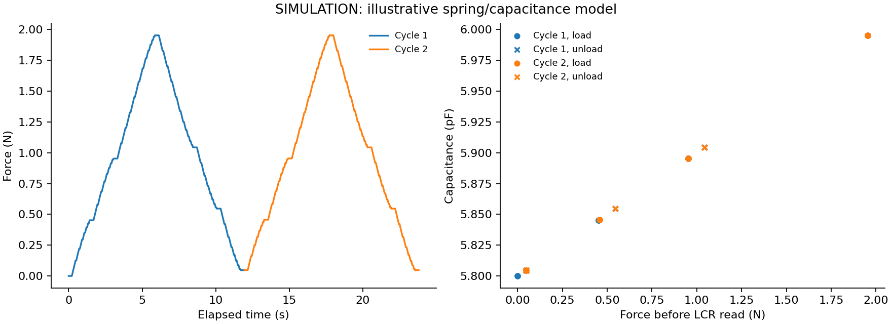
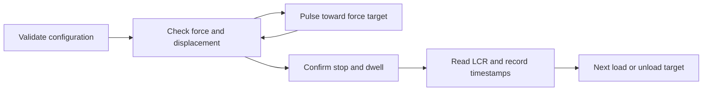

# Automated Mechanical Testing

A Python workflow for force-step loading/unloading and force–capacitance data review, organized around a **Mark-10 F305 with a 100 N force sensor** and an E4980A LCR adapter.

The offline demo runs a complete loading and unloading sequence with simulated instruments. Bench validation of the hardware adapters is pending.

## Engineering focus

- Bidirectional force-target pulses with force/displacement checks, target deadlines and abort handling.
- One acquisition loop owns instrument access; there are no competing serial-reader threads.
- A stop-reported dwell separates mechanical motion from potentially slow LCR reads.
- Explicit units, sequential observation timestamps and measurement-status fields.
- Run metadata, preserved partial logs and refusal to overwrite existing data.

The acquisition layer adapts patterns from existing Mark-10/QCoDeS bench programs. Its configuration, simulation, test suite and schema were organized during portfolio preparation. [Implementation notes](docs/IMPLEMENTATION.md) distinguish the historical evidence from this new software validation.

## Run without hardware

Python 3.9 or later. Simulation and its tests use the standard library; plotting uses Matplotlib.

```bash
python src/run_test.py --output outputs/demo.tsv
python -m pip install -r requirements.txt
python src/plot_force_steps.py --input outputs/demo.tsv --output outputs/demo.png
python -m unittest discover -s tests -v
```

The default mode is simulation. No serial/VISA driver is imported or device opened in this mode. Simulation advances a virtual clock and uses an illustrative spring/capacitance model, not a fit to experimental data. Each run creates a TSV and a JSON sidecar; use a new output stem for another run. Ctrl+C or an existing `ABORT` file ends a run.



The included TSV and JSON example use the simulated spring and capacitance model. See the [example data guide](examples/DATA_DICTIONARY.md) for the schema and optional commands for reviewing historical logs locally.

## Configuration and hardware

`config/example.json` contains the experiment settings and the confirmed 100 N sensor capacity. Its 5 N software cutoff and 0–2 N targets are demonstration settings, not validated working limits for a physical setup. The serial and VISA addresses are empty and `hardware_profile_verified` is false.

The E4980A adapter uses QCoDeS. See [F305 hardware profile](docs/HARDWARE.md), [data schema](docs/ACQUISITION_SCHEMA.md) and [validation record](docs/VALIDATION.md) before enabling hardware mode.



Dwell holds the commanded crosshead position; force may relax. Force and capacitance observations are sequential, not hardware-triggered or simultaneous.
